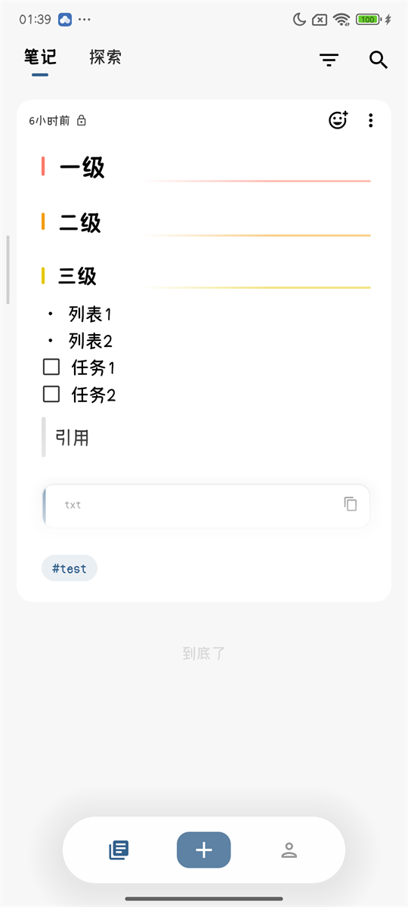
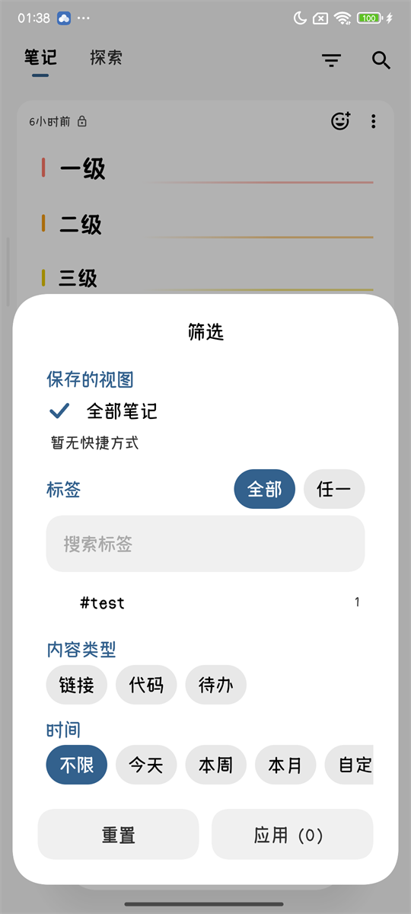
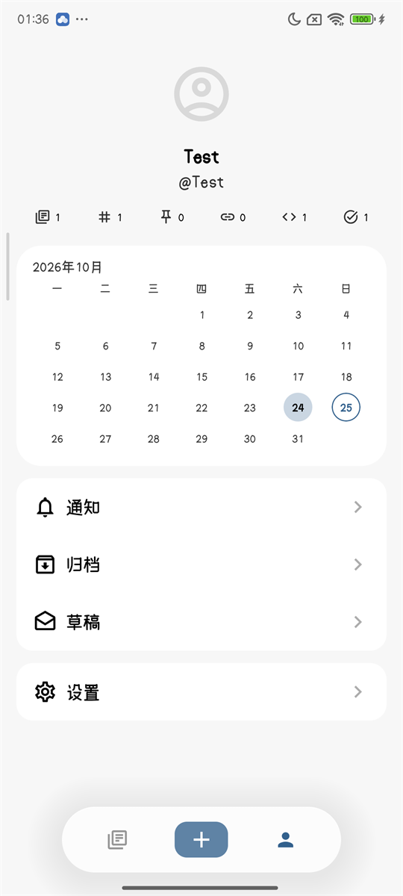
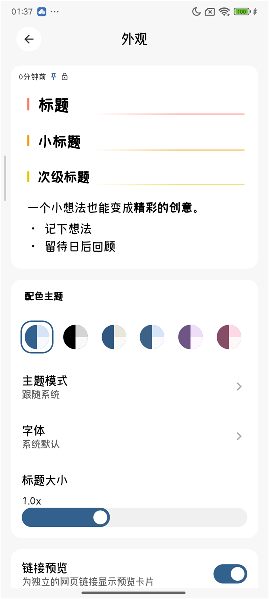
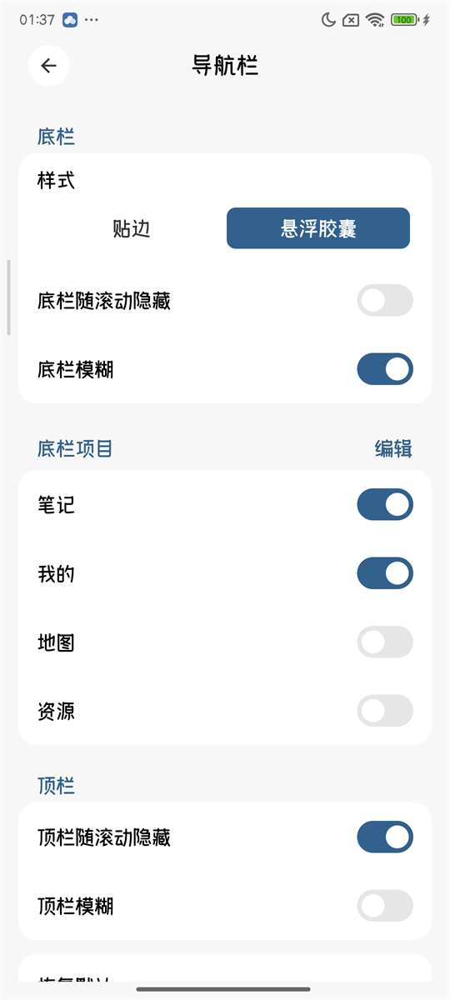
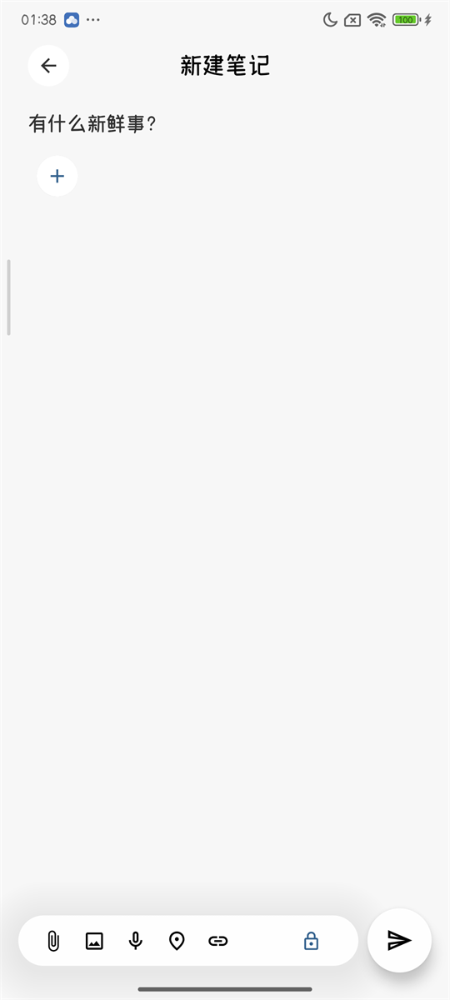

  

# MemosM

A development line of [yamada-sexta/memos-m](https://github.com/yamada-sexta/memos-m), rebuilt around the Miuix (HyperOS) design language, with the Material 3 path kept as an option.

[English](README.md) · [简体中文](README.zh-CN.md)

---

**Everything about the app itself lives in the original repository:** what it is, installation, the full
feature list, server support, SSO, downloads and how to build it — see
[yamada-sexta/memos-m](https://github.com/yamada-sexta/memos-m). This repository continues from there;
below is only what changed here.

## Screenshots

  
  
  
   
  
  
  

## What changed here

- **Miuix (HyperOS) redesign.** Theme foundation, main shell, settings, dialogs, forms, memo cards,
  markdown blocks, motion and every loading indicator were moved onto Miuix components: the grouped
  cards, the frosted surfaces, the floating capsule bottom bar and the dot-matrix loader all come from
  that pass. This branch keeps both design languages — Material 3 and Miuix, switchable in the
  appearance settings with Miuix as the default; `small` removes the Material 3 path and the switch,
  leaving Miuix as the only design language.
- **Structured filter system.** A filter panel over the feed with saved views, a collapsible tag tree,
  content types (links/code/todos), date presets and custom ranges, compiled to the server's CEL filter
  and mirrored locally for offline use. The applied filter stays readable as removable tokens under the
  top bar.
- **Navigation settings.** Bottom bar edge-to-edge or as a floating capsule, hide-on-scroll, frosting,
  reorderable destinations, plus the rail on tablets; the edit gesture for memo cards is configurable.
- **Launcher shortcuts.** Four dynamic shortcuts: new memo, drafts, notifications and search.
- **Markdown work.** Code blocks with syntax highlighting, optional line numbers and wrapping, LaTeX
  rendering, plain-text rendering for previews and shares, link previews and share dialogs.
- **Startup performance.** The first frame is painted before the startup gates resolve, a launch shell
  mirrors the real feed's geometry, the feed opens on skeleton cards, and a baseline profile plus
  macrobenchmarks keep it honest.
- **Offline and sync hardening.** Memos are created locally first, the offline outbox was hardened
  across writes, replay, attachments and restore, and background polling no longer reconciles on every
  overlay.
- **Scroll and gesture polish.** A page only moves as far as its content goes (no overshoot bounce),
  pull-to-refresh needs a deliberate pull, and programmatic list shifts no longer flip the chrome.
- **Release engineering.** ABI-split APKs, R8 with keep rules for the reflect-driven API and model
  classes, signing from `keystore.properties` or CI environment variables, and a `benchmark` build type.
- **Tests.** Unit tests for the filter model, markdown, navigation, appearance and account isolation;
  the API integration suite stays behind Testcontainers.

## License

[MIT](LICENSE), as the original repository.
